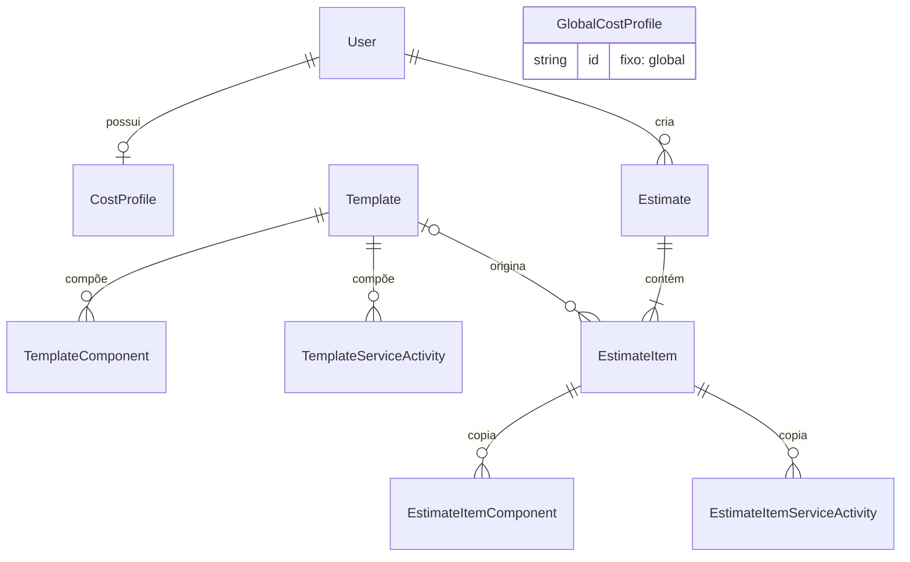

# Modelo de dados do PriceFunc

O banco é **PostgreSQL** (Supabase), acessado exclusivamente pela API NestJS
por meio do **Prisma ORM**. O schema fica em
[`apps/api/prisma/schema.prisma`](../apps/api/prisma/schema.prisma) e as
alterações são versionadas em `apps/api/prisma/migrations`.

## Visão geral

O modelo se divide em três grupos:

- **Acesso e custos:** usuários e seus parâmetros comerciais.
- **Catálogo:** arquétipos reutilizáveis e sua composição.
- **Estimativas:** orçamentos salvos como cópias fixas do catálogo e
  do perfil de custo no momento da criação.

## Entidades

### Acesso e custos

| Tabela | Finalidade | Campos principais |
| --- | --- | --- |
| `User` | Usuário autenticado | `username` e `email` únicos, `password` (hash bcrypt), `role` (`user`, `admin`, `super_admin`) |
| `CostProfile` | Perfil comercial individual (1:1 com o usuário) | `hourlyRate`, `hoursPerPf`, `riskMargin`, `profitMarkup`, `taxRate` |
| `GlobalCostProfile` | Perfil comercial único da organização (registro `id = 'global'`) | mesmos parâmetros + `isActive`; quando ativo, prevalece sobre o perfil individual |

### Catálogo

| Tabela | Finalidade | Campos principais |
| --- | --- | --- |
| `Template` | Arquétipo reutilizável | `name` único, `category`, `description`, `calculationBasis` (`function-points` ou `service-hours`), totais por tipo `pfAli`…`pfCe` |
| `TemplateComponent` | Função que compõe um arquétipo por PF | `functionType` (ALI, AIE, EE, SE, CE), `complexity` (`low`, `medium`, `high`), `quantity`, `unitPf`, `totalPf` |
| `TemplateServiceActivity` | Atividade de um arquétipo por horas | `name`, `description`, `estimatedHours` |

### Estimativas

| Tabela | Finalidade | Campos principais |
| --- | --- | --- |
| `Estimate` | Orçamento de um usuário | `title`, `clientName`, `presetKey`, `status` (`draft`, `sent`), `scopeBoundary`, `calculationNotes`, `sentAt` |
| `EstimateItem` | Item da lousa | `kind` (`archetype` ou `custom`), `templateId` (opcional), `quantity`, `calculationBasis`, `totalPf`, `serviceHours` |
| `EstimateItemComponent` | Cópia das funções do item | mesmos campos de `TemplateComponent` |
| `EstimateItemServiceActivity` | Cópia das atividades do item | mesmos campos de `TemplateServiceActivity` |

Além da identificação, `Estimate` guarda todos os dados comerciais do cálculo:

- **Parâmetros usados:** `hourlyRate`, `hoursPerPf`, `riskMargin`,
  `profitMarkup`, `taxRate` e `pricingSource` (`user` ou `global`).
- **Resultados:** `totalPf`, `functionPointHours`, `serviceHours`,
  `estimatedHours`, `baseCost`, `riskAmount`, `profitAmount`, `taxAmount` e
  `totalPrice`.

## Regras do modelo

- **Orçamento preservado.** Ao salvar uma estimativa, componentes, atividades e
  parâmetros são copiados. Alterar o catálogo ou o perfil de custo depois não
  muda orçamentos já emitidos.
- **Cálculo no servidor.** Todos os totais são recalculados pela API antes de
  gravar; valores enviados pelo navegador não são persistidos diretamente.
- **Exclusões.** Apagar um usuário remove seu perfil e suas estimativas; apagar
  um arquétipo remove seus componentes e atividades, mas os itens de estimativa
  que o usavam são preservados (`templateId` passa a nulo).
- **Isolamento por usuário.** Estimativas são sempre consultadas filtrando pelo
  usuário autenticado.
- **Domínios como texto.** Papéis, status, categorias, tipos de função e
  complexidades são gravados como `String`; os valores válidos são garantidos
  pela validação da API e pelos tipos de `packages/shared`.
- **Identificadores e auditoria.** Todas as tabelas usam UUID como chave
  (exceto o perfil global) e registram `createdAt`; as editáveis também
  registram `updatedAt`.

## Índices

| Tabela | Índice | Uso |
| --- | --- | --- |
| `Estimate` | `(userId, createdAt)` | Listagem das estimativas do usuário |
| `Estimate` | `(userId, status, sentAt)` | Últimos orçamentos enviados no dashboard |
| Tabelas filhas | chave estrangeira do pai | Carregamento da composição |

## Dados iniciais

O seed (`apps/api/prisma/seed.ts`) é idempotente e garante:

- o usuário administrador definido pelas variáveis `ADMIN_*`;
- os oito arquétipos funcionais e o serviço consultivo **Avaliação de Riscos**;
- o registro do perfil global, criado desativado.
